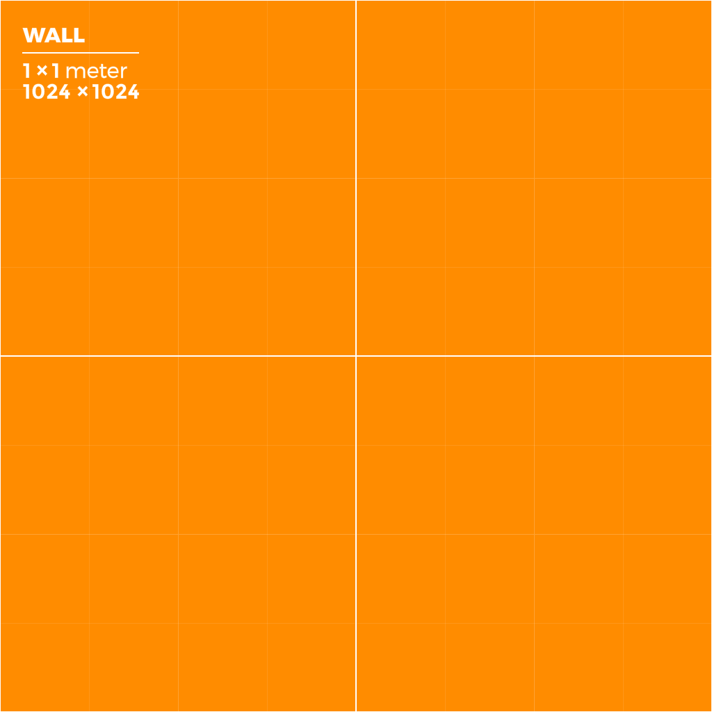

# Materials
> Material asset: `.mat` JSON (`core/assets/matp/materials.py:14-169`) resolved/cached by `MaterialManager` (`core/renderer/mats/manager.py:54-80`).
[Home](../../index.md) · [Section index](./_section.md)
## Overview
`Material { name, shader_path, properties }`. `shader_path = "default"` maps to the built-in PBR; otherwise resolved against project root then engine `core/shaders/` (`materials.py:26-46`). Missing files warn once and fall back to default (`manager.py:63-71`). `MeshRenderer.materials[i].path` points at `.mat` files.
## Properties
| name | type | default | description |
|---|---|---|---|
| `name` | string | `""` | Material name (`materials.py:14-24`). |
| `shader_path` | string | `"default"` | `.shader` path or `default` (`materials.py:48-52,110-118`). |
| `properties` | object | `{}` | Shader uniforms incl. `_BaseColor`, `_Metallic`, `_Smoothness` (`manager.py:89-96`). |
## Usage in Editor
Create `.mat` in Assets, pick Shader, edit exposed properties. Assign to [Mesh Renderer](./mesh-renderer.md) material slots.
## Usage in Code
```python
from core.assets.matp import Material
m = Material.load("assets/materials/Brick.mat", project_root)
```
## Material/Shader snippet
`assets/materials/ProBuilderPrototype.mat` (verbatim):
```json
{"name": "ProBuilderPrototype", "properties": {"_BaseColor": [1.0, 1.0, 1.0, 1.0], "_EmissionColor": [0.0, 0.0, 0.0, 0.0], "_EmissionIntensity": 0.0, "_Metallic": 0.0, "_Smoothness": 0.5, "albedo_texture": "../textures/prototype_texture.png"}, "shader_path": "default"}
```
## Screenshots



> `prototype_texture.png` used by `assets/materials/ProBuilderPrototype.mat`
> as `albedo_texture`. File: `assets/screenshots/prototype-texture.png`
> (verified copy of engine `prototype_texture.png`; identical to
> `assets/textures/prototype_texture.png` in the engine repo).

## Related pages
- [Shaders](./shaders.md), [Mesh Renderer](./mesh-renderer.md), [Pipeline](./pipeline.md)
## Verified against
- `core/assets/matp/materials.py:14-169`
- `core/renderer/mats/manager.py:54-100`
- `assets/materials/ProBuilderPrototype.mat`
