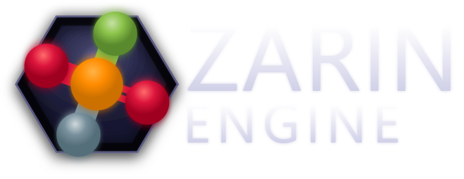

<p align="center">
  
</p>

# ZarinEngine Wiki

| EN | RU |
|---|---|
| [English →](en/getting-started/index.md) | [Русский →](ru/getting-started/index.md) |


## What is ZarinEngine / Что такое ZarinEngine

EN: ZarinEngine is a 3D game and simulation engine written entirely in Python — ECS-based, Unity-like workflow (hierarchy, components, inspector, prefabs), with a full PySide6 visual editor and real-time ModernGL rendering. MPL-2.0, © 2026 Zarrakun.

RU: ZarinEngine — 3D-игровой и симуляционный движок целиком на Python: ECS, Unity-подобный уклад (иерархия, компоненты, инспектор, префабы), полноценный визуальный редактор на PySide6 и real-time рендер на ModernGL. MPL-2.0, © 2026 Zarrakun.

## Quick start / Быстрый старт

```bash
pip install -r requirements.txt
python main.py
python player.py SampleScene.zpes
python build_nuitka.py
```

EN: `main.py` opens the editor; `player.py <scene.zpes>` runs a game from a scene file; `build_nuitka.py` compiles a standalone player (Nuitka, defaults in `tools/nuitka/config.py`, per-project scenes/plugins in the Build Settings dialog — repo-root sample `_build_BuildSettings.json`; no `build_profiles.json` exists in the repo).

RU: `main.py` открывает редактор; `player.py <scene.zpes>` запускает игру из файла сцены; `build_nuitka.py` собирает standalone-плеер (Nuitka, дефолты в `tools/nuitka/config.py`, сцены/плагины проекта — в диалоге Build Settings; образец в корне `_build_BuildSettings.json`; `build_profiles.json` в репо нет).

## Documentation map / Карта документации

| Section / Раздел | EN | RU |
|---|---|---|
| Getting started / Начало работы | [en/getting-started/](en/getting-started/index.md) | [ru/getting-started/](ru/getting-started/index.md) |
| Core (ECS, Entity, lifecycle, config, logging, profiler) / Ядро | [en/core/](en/core/ecs-overview.md) | [ru/core/](ru/core/ecs-overview.md) |
| Rendering (pipeline, cameras, lights, meshes, materials, shaders, gizmos) / Рендеринг | [en/rendering/](en/rendering/overview.md) | [ru/rendering/](ru/rendering/overview.md) |
| PostFX stack / Стек PostFX | [en/rendering/postfx](en/rendering/postfx.md) | [ru/rendering/postfx](ru/rendering/postfx.md) |
| Object effects / Эффекты объектов | [en/rendering/effects](en/rendering/effects.md) | [ru/rendering/effects](ru/rendering/effects.md) |
| Physics 3D / Физика 3D | [en/physics-3d/](en/physics-3d/overview.md) | [ru/physics-3d/](ru/physics-3d/overview.md) |
| Physics 2D / Физика 2D | [en/physics-2d/](en/physics-2d/overview.md) | [ru/physics-2d/](ru/physics-2d/overview.md) |
| Audio (OpenAL) / Аудио | [en/audio/](en/audio/overview.md) | [ru/audio/](ru/audio/overview.md) |
| Scripting (lifecycle, hot reload) / Скриптинг | [en/scripting/](en/scripting/overview.md) | [ru/scripting/](ru/scripting/overview.md) |
| GUI (canvas, controls, containers) / Интерфейс | [en/gui/](en/gui/overview.md) | [ru/gui/](ru/gui/overview.md) |
| Animation / Анимация | [en/animation/](en/animation/overview.md) | [ru/animation/](ru/animation/overview.md) |
| Navigation / Навигация | [en/navigation/](en/navigation/overview.md) | [ru/navigation/](ru/navigation/overview.md) |
| Terrain & environment / Террейн и окружение | [en/terrain-environment/](en/terrain-environment/terrain.md) | [ru/terrain-environment/](ru/terrain-environment/terrain.md) |
| Constraints / Ограничения | [en/constraints/](en/constraints/overview.md) | [ru/constraints/](ru/constraints/overview.md) |
| Scenes & prefabs / Сцены и префабы | [en/scenes-prefabs/](en/scenes-prefabs/scenes.md) | [ru/scenes-prefabs/](ru/scenes-prefabs/scenes.md) |
| Assets & import (Assimp, textures, .import) / Ассеты и импорт | [en/assets/](en/assets/overview.md) | [ru/assets/](ru/assets/overview.md) |
| Input / Ввод | [en/input/](en/input/overview.md) | [ru/input/](ru/input/overview.md) |
| Math (Vec, Quat, Mat4, Curve) / Математика | [en/math/](en/math/overview.md) | [ru/math/](ru/math/overview.md) |
| Networking (gameplay + collaboration) / Сеть | [en/networking/](en/networking/overview.md) | [ru/networking/](ru/networking/overview.md) |
| Plugins (PluginBase, system, user, .zplugin) / Плагины | [en/plugins/](en/plugins/overview.md) | [ru/plugins/](ru/plugins/overview.md) |
| Editor manual / Руководство по редактору | [en/editor/](en/editor/main-window.md) | [ru/editor/](ru/editor/main-window.md) |
| Build (player, Nuitka) / Сборка | [en/build/](en/build/player-nuitka.md) | [ru/build/](ru/build/player-nuitka.md) |
| File formats / Форматы файлов | [en/formats/](en/formats/overview.md) | [ru/formats/](ru/formats/overview.md) |
| Tutorials / Уроки | [en/tutorials/](en/tutorials/index.md) | [ru/tutorials/](ru/tutorials/index.md) |
| Tutorials: FPS, Network, Plugin, Shader / Уроки: FPS, сеть, плагин, шейдер | [en/tutorials/fps-controller.md](en/tutorials/fps-controller.md) | [ru/tutorials/fps-controller.md](ru/tutorials/fps-controller.md) |
| Scripting cookbook / Кулинария скриптинга | [en/scripting/cookbook/patterns.md](en/scripting/cookbook/patterns.md) | [ru/scripting/cookbook/patterns.md](ru/scripting/cookbook/patterns.md) |
| Core advanced (authoring, undo, events, threading) / Продвинутое ядро | [en/core/advanced/component-authoring.md](en/core/advanced/component-authoring.md) | [ru/core/advanced/component-authoring.md](ru/core/advanced/component-authoring.md) |
| Rendering library (shaders, units, pipelines) / Библиотека рендеринга | [en/rendering/library/shader-catalog.md](en/rendering/library/shader-catalog.md) | [ru/rendering/library/shader-catalog.md](ru/rendering/library/shader-catalog.md) |
| Physics solvers / Солверы физики | [en/physics-3d/solvers/culverin.md](en/physics-3d/solvers/culverin.md) | [ru/physics-3d/solvers/culverin.md](ru/physics-3d/solvers/culverin.md) |
| Network protocol (NET_*, RPC) / Сетевой протокол | [en/networking/protocol/message-types.md](en/networking/protocol/message-types.md) | [ru/networking/protocol/message-types.md](ru/networking/protocol/message-types.md) |
| Plugin catalog (VR, MCP, music) / Каталог плагинов | [en/plugins/catalog/vr-setup.md](en/plugins/catalog/vr-setup.md) | [ru/plugins/catalog/vr-setup.md](ru/plugins/catalog/vr-setup.md) |
| Reference (API index, glossary, roadmap, license) / Справочник | [en/reference/](en/reference/api-index.md) | [ru/reference/](ru/reference/api-index.md) |
| Appendix (config, CLI, troubleshooting, perf, tests, tools) / Приложение | [en/appendix/config-reference.md](en/appendix/config-reference.md) | [ru/appendix/config-reference.md](ru/appendix/config-reference.md) |

## Requirements / Требования

- Python 3.13+ (minimums per `docs/.../requirements.md`; `requirements.txt` lists bare package names without pins)
- PySide6 (≥ 6.6 per docs; bare name in `requirements.txt`)
- ModernGL (≥ 5.10 per docs; bare name in `requirements.txt`)
- NumPy (≥ 1.26 per docs; bare name in `requirements.txt`)
- Full package list in `requirements.txt`: `PySide6, moderngl, numpy, pyopenal, miniaudio, pynput, msgpack, websockets, cython, setuptools, nuitka, pillow, imageio, qtawesome, xxhash, psutil, culverin, pyyaml`
- OpenGL 4.6 Core
- OpenAL (system library / системная библиотека)
- Assimp (bundled DLL/SO for mesh import / bundled DLL/SO для импорта мешей)

## File formats / Форматы файлов

| Extension / Расширение | Type / Тип |
|---|---|
| `.zpes` | Scene file, JSON / Файл сцены, JSON |
| `.zpem` / `.mat` | Material file (`.mat` is an accepted alias) / Файл материала (`.mat` — принимаемый алиас) |
| `.zpep` | Prefab file / Файл префаба |
| `.shader` | Shader file, custom format with `Properties` block + GLSL / Файл шейдера, свой формат с блоком `Properties` + GLSL |
| `.import` | Per-asset import settings, JSON / Настройки импорта ассета, JSON |

## Language / Язык

| EN | RU |
|---|---|
| Start: [en/getting-started/index.md](en/getting-started/index.md) | Начало: [ru/getting-started/index.md](ru/getting-started/index.md) |

## Media / Медиа


- Editor screenshot (verified copy of engine `zarin_screenshot.png`):
  `assets/screenshots/editor-main.png`
- Logo (verified copy of engine `zarin_logo.svg`):
  `assets/screenshots/zarin-logo.svg`
- Prototype texture (verified copy of engine `prototype_texture.png`):
  `assets/screenshots/prototype-texture.png`
- Repo history visualization (verified copy of engine `gource-0001.png`):
  `assets/screenshots/gource.png`
- Screen recordings (no `.gif` in the engine repo yet):
  `assets/gifs/README.md` explains how to record (ScreenToGif/Peek/LICEcap,
  800 px width, < 5 MB).
