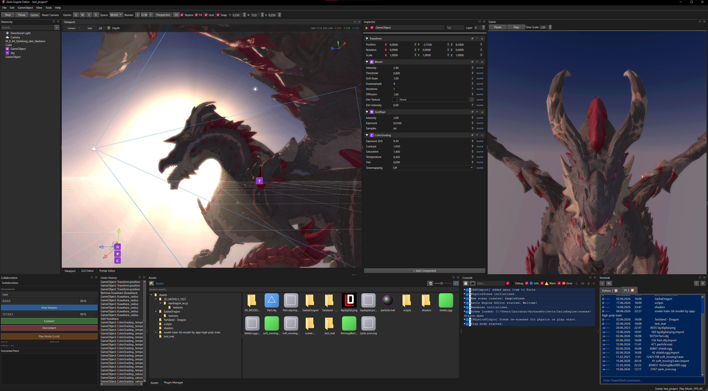

# Главное окно

> `EditorMainWindow` (`editor/main_window/widgetp/frame.py`) — оболочка-`QMainWindow` редактора: доки, тулбар, меню, статус-бар, автосохранение сессии.

## API / Properties

| Член | Сигнатура | Примечания |
|---|---|---|
| `EditorMainWindow` | `(engine: Engine)` | Миксины `_ToolbarHostMixin`, `_StatusMixin`; реэкспорт в `editor/main_window.py` |
| `_setup_engine_events` | `(self)` | Привязка сигналов движка к окну |
| `_schedule_session_autosave` | `(delay_ms: int = 5000)` | Отложенное сохранение сессии |
| `_flush_session_autosave` | `(self)` | Запись отложенного снапшота сессии |
| `closeEvent` | `(event: QCloseEvent)` | Сброс при закрытии окна |
| `toggle_play_stop` | `(mw)` в `main_window/handlersp/play.py` | Кнопка Play/Stop + действие `Shift+F10` |
| `toggle_pause` | `(mw)` в `main_window/handlersp/play.py` | Кнопка паузы |
| `launch_external_player` | `(mw)` в `main_window/handlersp/play.py` | Кнопка « Player» тулбара |
| `on_open_prefab_editor` | `(mw, path: str)` в `handlersp/prefab.py` | Вкладка префаба, запуск автосохранения |
| `on_project_file_double_clicked` | `(mw, path: str)` в `handlersp/prefab.py` | Маршрутизация дабл-клика по файлам проекта |
| `on_entity_dropped` | `(mw, path_or_type: str, world_pos, entity_under_cursor=None)` в `handlersp/drop_assets.py` | Дропы во вьюпорт (материал/картинка/аудио/модель) |
| `_StatusMixin._update_status` | `(self)` | Обновление статус-бара, включая монитор железа (`_HwMonitorWorker`: cpu/ram/gpu/vram) |

## Usage in Editor

Горячие клавиши меню, проверенные в `main_window/menup/builder.py`:

| Действие | Клавиши |
|---|---|
| New Scene | `Ctrl+N` |
| Open Scene... | `Ctrl+O` |
| Save Scene | `Ctrl+S` |
| Save Scene As... | `Ctrl+Shift+S` |
| Save All Scenes | `Ctrl+Alt+S` |
| Create Empty (меню GameObject) | `Ctrl+Shift+N` |
| Play/Stop | `Shift+F10` |
| Exit | `Alt+F4` |
| Search Everywhere (палитра команд) | `Ctrl+F` |

Дополнительные проверенные шорткаты в том же файле (тот же источник, вне краткой таблицы — все из `menup/builder.py`):

| Действие | Клавиши |
|---|---|
| Launch in Player | `F10` |
| Go to Tab... | `Ctrl+P` |
| Next / Previous Tab | `Ctrl+Tab` / `Ctrl+Shift+Tab` |
| Plugin Manager | `Ctrl+Shift+P` |
| Python Packages... | `Ctrl+Shift+K` |
| Mesh Editor | `Ctrl+Shift+M` |
| Terrain Editor | `Ctrl+Shift+T` |
| GUI Editor | `Ctrl+Shift+G` |
| Build Settings... | `Ctrl+Shift+U` |
| Build Project... | `Ctrl+Shift+B` |

Тулбар: Play/Stop (`toggle_play_stop`), Pause, кнопка ` Player` (тултип «Launch in standalone Player»), кнопка поиска (тултип «Search Everywhere (Ctrl+F)»), комбо режима навигации (тултип: WASD + осмотр RMB, пан MMB, долли колесом; Shift+RMB ставит курсор, Ctrl+MMB — долли).

## Usage in Code

```python
from editor.main_window.handlersp.play import toggle_play_stop, toggle_pause, launch_external_player

toggle_play_stop(mw)      # то же, что кнопка Play / Shift+F10
toggle_pause(mw)          # то же, что кнопка Pause
launch_external_player(mw)  # отдельный плеер для текущей сцены
```

## Скриншоты



> `EditorMainWindow`: доки, тулбар, вьюпорт, статус-бар.
> Файл: `assets/screenshots/editor-main.png` (проверенная копия
> `zarin_screenshot.png` из репозитория движка).

## Related

- Вьюпорт (вид сцены в главном окне), Иерархия, Инспектор, Панель проекта
- Диалог сборки / менеджер проектов / настройки (диалоги из меню)
- Плеер и сборка Nuitka (цель внешнего плеера)

## Verified against

- `editor/main_window.py`, `editor/main_window/widgetp/frame.py`, `editor/main_window/widgetp/status.py`, `editor/main_window/widgetp/toolbar_host.py`
- `editor/main_window/toolbar.py`, `editor/main_window/menup/builder.py`, `editor/main_window/statusbar.py`, `editor/main_window/connections.py`, `editor/main_window/postinit.py`, `editor/main_window/project.py`
- `editor/main_window/handlersp/play.py`, `editor/main_window/handlersp/prefab.py`, `editor/main_window/handlersp/drop_assets.py`
